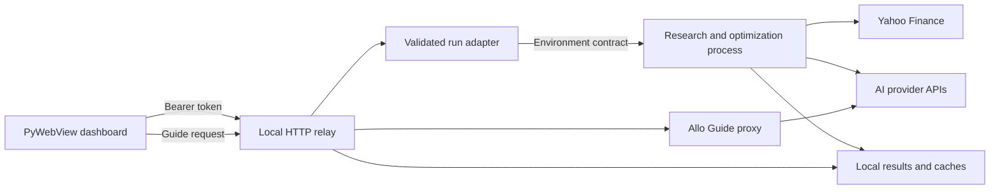

# AlloLabs

AlloLabs is a local desktop research system for global equity allocation. It converts market data and structured forecasts from large language models (LLMs) into Black–Litterman expected returns. The artificial intelligence (AI) research pipeline solves maximum-Sharpe and minimum-volatility portfolios, evaluates them on a held-out period, and produces auditable JSON, CSV, chart, and PDF artifacts.

AlloLabs does not connect to a broker or place orders. It is research software, not financial advice.

## What the system computes

Each run produces two fully invested portfolios from the same return vector, covariance matrix, and constraints:

| Portfolio | Objective | Primary interpretation |
|---|---|---|
| Maximum Sharpe | Maximize `(expected return - risk-free rate) / volatility` | Highest estimated excess return per unit of risk |
| Minimum volatility | Minimize annualized portfolio volatility | Lowest estimated variance under the active constraints |

The expected-return vector has two modes:

- **Statistical mode**: annualized sample means from the training window
- **AI-assisted mode**: a market-equilibrium prior updated with structured AI views through Black–Litterman

Both modes use the same stabilized annualized covariance matrix and Sequential Least Squares Programming (SLSQP) optimizer.

## Financial model

The financial pipeline separates data estimation, subjective views, portfolio construction, and evaluation. This separation makes each assumption visible in the output artifacts.

### Estimate returns and covariance

AlloLabs downloads adjusted prices from Yahoo Finance for the selected universe. It forward-fills isolated gaps, requires at least 80% price coverage per asset, and aligns complete daily return observations across the usable universe.

For daily return matrix $R$, the annualized sample estimates are:

$$
\mu_{hist} = 252 \cdot \operatorname{mean}(R)
$$

$$
\Sigma = 252 \cdot \operatorname{cov}(R)
$$

The covariance stabilizer symmetrizes $\Sigma$, floors small eigenvalues, and rejects non-finite inputs. A run requires at least two usable assets and 20 aligned return observations.

### Construct the market-equilibrium prior

When AI views are enabled, AlloLabs fetches current market capitalizations in parallel. Available values define the benchmark weights:

$$
w_m = \frac{\text{market cap}}{\sum_i \text{market cap}_i}
$$

The system substitutes the mean available capitalization for a missing value. It uses equal weights only when no market-cap data is available.

AlloLabs then computes reverse-optimized equilibrium returns:

$$
\pi = \delta \Sigma w_m
$$

The current implementation uses risk-aversion parameter $\delta = 2.5$ and prior uncertainty scale $\tau = 0.05$.

### Generate structured AI views

The research model receives a bounded batch of ticker records. Each record contains available valuation ratios, operating metrics, recent news titles, article summaries, and the optional investment mandate.

The provider must return one validated record per ticker:

```json
{
  "ticker": "AAPL",
  "industry": "Consumer Electronics",
  "view": "Probability-weighted 12-month rationale with upside and risk.",
  "expected_return": 0.08,
  "confidence": 0.67
}
```

`expected_return` is a decimal 12-month total-return estimate constrained to `[-1.0, 1.0]`. `confidence` measures forecast reliability and is constrained to `[0.01, 0.99]`. It does not represent business quality.

The analyst mandate acts as an investment policy frame. The prompt instructs the model to favor mandate-aligned evidence without overriding contradictory fundamentals. AlloLabs hashes the mandate and invalidates cached views when that hash changes.

### Convert confidence into view uncertainty

Each absolute ticker view defines one row of the pick matrix $P$ and one element of view vector $Q$. AlloLabs maps confidence $c_i$ into diagonal uncertainty:

$$
\omega_i = \max\left(10^{-10},\; [P(\tau\Sigma)P^T]_{ii}\frac{1-c_i}{c_i}\right)
$$

Higher confidence lowers $\omega_i$, so the posterior moves closer to the AI estimate. Lower confidence increases uncertainty and preserves more of the equilibrium prior.

The implemented Black–Litterman update is:

$$
\mu_{BL} = \pi + \tau\Sigma P^T\left(P\tau\Sigma P^T + \Omega\right)^{-1}(Q-P\pi)
$$

The solver falls back to a pseudoinverse if the view covariance is singular.

### Audit the cross-section

The optional global audit summarizes the complete validated research set, then processes bounded record batches with the same portfolio-wide calibration context. The auditor checks return dispersion, confidence calibration, sign consistency, mandate alignment, rationale quality, and cross-sectional bias without requiring one oversized response.

Audit mode is fail-closed. It requires AI views, a complete record set, and a configured audit-provider key. The optimizer does not continue with a partial audited universe.

The default audit batch contains 40 securities. Set `ALLOLABS_GPT_AUDIT_BATCH_SIZE` to a value from 5 through 100 to change that bound. AlloLabs retries one malformed or incomplete model response per batch, validates the merged ticker set, and preserves the original universe order.

Research and audit providers can differ. The analyst and auditor mandates also remain separate.

### Solve constrained portfolios

AlloLabs solves minimum volatility first and uses that solution as one maximum-Sharpe starting point. The maximum-Sharpe search also tests the feasible equal-weight allocation, a maximum-return corner, and an interpolation between minimum volatility and maximum return.

Every portfolio satisfies:

$$
\sum_i w_i = 1
$$

The active hard constraints are:

- Position bound `0 <= w_i <= cap` in long-only mode
- Position bound `-cap <= w_i <= cap` in long/short mode
- Optional upper sector exposure bound
- Matching lower sector bound in long/short mode
- Full investment with net weight equal to one

Before optimization, a feasibility solve verifies that the selected universe, position cap, and sector cap can form a portfolio.

Optional regularization shrinks weights toward equal weight. L2 uses $\lambda\lVert w-w_{eq}\rVert_2^2$. Smooth L1 uses a differentiable absolute-value approximation.

### Evaluate out of sample

When the out-of-sample (OOS) window is nonzero, the training period ends before the OOS period begins. The optimizer never uses OOS returns to estimate its weights.

AlloLabs applies the fixed training weights to surviving OOS assets, renormalizes those weights, and compares both portfolios with available benchmarks:

- `XIU.TO` for the TSX 60
- `SPY` for the S&P 500
- `QQQ` for the Nasdaq 100
- `ISF.L` for the FTSE 100
- `^STOXX50E` for the Euro STOXX 50

The output includes cumulative returns, annualized volatility, annualized Sharpe ratios, and Jobson–Korkie tests against each downloaded benchmark.

## How AI is used

AlloLabs has two independent AI planes. The research plane creates portfolio inputs. The Guide plane explains the system and prepares configuration, but it cannot execute a run.

### Research and audit plane

The research plane runs inside `allolabs.py`:

1. Fetch fundamentals and news for each research ticker
2. Build provider-specific structured-output requests
3. Validate ticker coverage, return bounds, confidence bounds, and JSON structure
4. Reuse mandate-consistent cached records when available
5. Optionally audit bounded batches against a shared cross-sectional summary
6. Convert the final records into Black–Litterman inputs

Supported research and audit providers are:

| Provider | Environment variable | Research default | Audit default |
|---|---|---|---|
| OpenAI | `OPENAI_API_KEY` | `gpt-5.4` | `gpt-5.5` |
| Anthropic | `ANTHROPIC_API_KEY` | `claude-sonnet-4-6` | `claude-opus-4-8` |
| Google Gemini | `GEMINI_API_KEY` | `gemini-3.5-flash` | `gemini-3.1-pro-preview` |
| DeepSeek | `DEEPSEEK_API_KEY` | `deepseek-chat` | `deepseek-reasoner` |

The desktop interface exposes an allowlisted model catalog for both stages. Provider requests use native structured-output formats where available. DeepSeek uses JSON mode plus local schema validation.

The selectable research and audit catalog is:

| Provider | Model identifiers |
|---|---|
| OpenAI | `gpt-5.5`, `gpt-5.4`, `gpt-5.4-mini`, `gpt-5.4-nano` |
| Anthropic | `claude-fable-5`, `claude-opus-4-8`, `claude-sonnet-4-6`, `claude-haiku-4-5` |
| Google Gemini | `gemini-3.5-flash`, `gemini-3.1-pro-preview`, `gemini-3.1-flash-lite`, `gemini-3-flash-preview`, `gemini-2.5-pro`, `gemini-2.5-flash`, `gemini-2.5-flash-lite` |
| DeepSeek | `deepseek-chat`, `deepseek-reasoner` |

### Allo Guide plane

The Guide runs through `allolabs_guide.py` and the authenticated `/api/guide` relay. It supports finance explanations, mandate drafting, universe design, run diagnostics, portfolio interpretation, and configuration generation.

Each turn can include a synthetic application snapshot with:

- Selected tickers and market groups
- Current Console settings
- Latest portfolio metrics and holdings
- Available AI research records
- Current run status and active view

Ticker-related questions also receive the complete 947-security catalog. The system prompt requires every suggested symbol to appear in that catalog.

The Guide returns conversational text plus a hidden metadata block. A `run_config` response can render an inline configuration card, but you must load it into Console and start the run yourself.

Long sessions compact into a structured summary. The browser retains up to four prior summaries in local storage and restores them as memory context.

Guide providers and defaults are:

| Provider | Default model | Scope |
|---|---|---|
| Anthropic | `claude-sonnet-4-6` | Guide, research, audit |
| OpenAI | `gpt-4o-mini` | Guide, research, audit |
| Google Gemini | `gemini-2.5-flash` | Guide, research, audit |
| DeepSeek | `deepseek-chat` | Guide, research, audit |
| Nvidia NIM | `meta/llama-3.3-70b-instruct` | Guide only |

## System architecture

AlloLabs packages a web interface inside a native PyWebView window. The interface communicates with a constrained local HTTP relay, which launches the numerical pipeline as a separate process.



The main components are:

| Component | Responsibility |
|---|---|
| `desktop/app.py` | Creates a one-time token, binds a random localhost port, starts the relay, opens PyWebView, and shuts down child processes |
| `dashboard/server.py` | Authenticates requests, validates run configuration, serves local assets and artifacts, stores run state, and proxies Guide calls |
| `dashboard/runner.py` | Converts validated JSON settings into a bounded environment contract and normalizes pipeline results for the dashboard |
| `allolabs.py` | Fetches data, calls research providers, computes the posterior, solves portfolios, evaluates OOS returns, and writes artifacts |
| `allolabs_guide.py` | Builds Guide prompts, injects application context, routes provider requests, compacts sessions, and parses configuration metadata |
| `allolabs_report.py` | Resolves sectors and generates the portfolio report |
| `allolabs_report_memo.py` | Builds the allocation memorandum, exhibits, security briefs, and sensitivity analysis |

### Process and data flow

The desktop run path has explicit boundaries:

1. The browser posts JSON settings to `/api/run`
2. The relay validates types, ranges, tickers, providers, and models
3. The run adapter serializes approved values into `ALLOLABS_*` environment variables
4. The relay starts the fixed AlloLabs worker command without an interactive shell
5. The worker streams combined output into an in-memory log buffer
6. The pipeline writes results atomically to the user-data directory
7. The dashboard reloads normalized JSON and local report artifacts

### Security model

AlloLabs limits the local interface rather than treating localhost as trusted:

- The desktop shell binds to `127.0.0.1` on a random port
- Each launch creates a 32-byte URL-safe token
- Authenticated endpoints require `Authorization: Bearer <token>`
- Cross-origin requests are restricted to the active host or local file origin
- Research providers, models, regularization methods, and tickers use allowlists
- Numeric and Boolean fields receive strict type and range validation
- API keys stay in the process environment and never appear in dashboard payloads
- Provider status exposes only a masked key preview
- The relay launches fixed application commands, not user-supplied shell text

Remote binding is a developer feature. It requires `ALLOLABS_REMOTE_TOKEN` and should sit behind a trusted HTTPS reverse proxy and firewall.

## Install AlloLabs

Install a packaged desktop build unless you plan to modify the source.

### Install on Windows

Download an artifact from [GitHub Releases](https://github.com/JXaeyFin/AlloLabs/releases):

| File | Use |
|---|---|
| `AlloLabs-Setup-1.4.0.exe` | Per-user installer with Start Menu and Desktop shortcuts |
| `AlloLabs-v1.4.0-Windows-x64.zip` | Portable build that runs after extraction |

The installer writes to `%LOCALAPPDATA%\Programs\AlloLabs` and does not require administrator privileges. Run `Uninstall-AlloLabs.ps1` from the install directory to remove it.

### Install on macOS or Linux

Download the archive for your platform:

```text
AlloLabs-v1.4.0-macOS-arm64.zip
AlloLabs-v1.4.0-macOS-x64.zip
AlloLabs-v1.4.0-Linux-x64.tar.gz
AlloLabs-v1.4.0-Linux-arm64.tar.gz
```

On macOS, Control-click the application and select **Open** if Gatekeeper reports an unsigned publisher. On Linux, set executable permission when required:

```bash
chmod +x AlloLabs AlloLabsWorker
```

### Run from source

Source execution requires Python 3.11 or newer.

```bash
git clone https://github.com/JXaeyFin/AlloLabs.git
cd AlloLabs
python -m venv .venv
```

Activate the environment and install the numerical dependencies:

```powershell
.venv\Scripts\Activate.ps1
python -m pip install -r requirements.txt
```

```bash
source .venv/bin/activate
python -m pip install -r requirements.txt
```

Set at least one provider key if you plan to enable AI views or use the Guide. Only the selected provider receives a request.

```powershell
$env:OPENAI_API_KEY="your_openai_api_key_here"
$env:ANTHROPIC_API_KEY="your_anthropic_api_key_here"
$env:GEMINI_API_KEY="your_gemini_api_key_here"
$env:DEEPSEEK_API_KEY="your_deepseek_api_key_here"
$env:NVIDIA_NIM_API_KEY="your_nvidia_nim_api_key_here"
```

Launch the desktop application:

```powershell
pythonw -m desktop.app
```

Use `python -m desktop.app` when `pythonw` is unavailable or when you need startup diagnostics.

## Configure a run

The Console validates all user-facing settings before it starts the worker.

| Setting | Valid range or values | Desktop default |
|---|---|---|
| Training lookback | 0.25 to 10 years | 1 year |
| OOS window | 0 to 60 whole months | 6 months |
| Position cap | 1% to 100% | 25% |
| Sector cap | 5% to 100% | 100% |
| Long only | `true` or `false` | `true` |
| Regularization | `none`, `l2`, `smooth_l1` | `none` |
| Regularization strength | 0 to 10 | 0 when disabled |
| News articles per ticker | 1 to 20 | 5 |
| Research batch size | 1 to 30 | 12 |
| Analyst mandate | Up to 12,000 characters | Empty |
| Auditor mandate | Up to 12,000 characters | Empty |

The universe selector contains 947 unique symbols across six market groups. The relay rejects unsupported symbols and requires at least two selected securities.

### Run the pipeline without the desktop interface

`allolabs.py` reads configuration from environment variables. This example enables AI research, a separate audit provider, regularization, and a six-month OOS period:

```powershell
$env:ALLOLABS_TRAINING_YEARS="2"
$env:ALLOLABS_OOS_YEARS="0.5"
$env:ALLOLABS_MAX_POSITION_WEIGHT="0.15"
$env:ALLOLABS_MAX_SECTOR_WEIGHT="0.35"
$env:ALLOLABS_LONG_ONLY="true"
$env:ALLOLABS_REGULARIZATION="l2"
$env:ALLOLABS_REGULARIZATION_STRENGTH="0.25"
$env:ALLOLABS_GPT_VIEWS="true"
$env:ALLOLABS_RESEARCH_PROVIDER="anthropic"
$env:ALLOLABS_RESEARCH_MODEL="claude-sonnet-4-6"
$env:ALLOLABS_GPT_AUDIT="true"
$env:ALLOLABS_AUDIT_PROVIDER="gemini"
$env:ALLOLABS_GPT_AUDIT_MODEL="gemini-3.1-pro-preview"
$env:ALLOLABS_MAX_NEWS_ARTICLES="10"
$env:ALLOLABS_RESEARCH_BATCH_SIZE="12"
python allolabs.py
```

See `.env.example` for the remaining overrides. Do not commit credentials or a populated `.env` file.

## Inspect run artifacts

The pipeline writes machine-readable state and presentation artifacts to the application data directory.

| Artifact | Contents |
|---|---|
| `latest_run.json` | Complete normalized run state consumed by the dashboard |
| `black_litterman_stock_analysis.json` | Research views, prior returns, posterior returns, confidence, and mandate hash |
| `gpt_audited_views.json` | Audited records and cross-sectional change summary |
| `gpt_views.csv` | Tabular AI-view export |
| `portfolio_allocations.csv` | Portfolio weights and security metadata |
| `portfolio_vs_markets_oos.png` | OOS cumulative-return comparison |
| `allolabs_portfolio_report.pdf` | Portfolio report and allocation memorandum |
| `listing_metadata_cache.json` | Cached exchange, market, currency, and company metadata |
| `sector_cache.json` | Cached sector classifications |
| `run-history/` | Timestamped snapshots of configs, results, charts, reports, and AI records |

Desktop data paths are:

| Platform | Data directory |
|---|---|
| Windows | `%LOCALAPPDATA%\AlloLabs` |
| macOS | `~/Library/Application Support/AlloLabs` |
| Linux | `${XDG_DATA_HOME:-~/.local/share}/AlloLabs` |

## Build desktop packages

The build scripts create separate desktop and worker executables so numerical work remains outside the UI process.

### Build for Windows

```powershell
python -m pip install -r requirements-desktop-win.txt
powershell -ExecutionPolicy Bypass -File scripts/build-desktop.ps1
```

The script builds the PyInstaller directory under `dist/`. It also creates an Inno Setup installer under `release/` when Inno Setup 6 is installed. Pass `-SkipInstaller` to omit the installer stage.

### Build for macOS or Linux

```bash
python -m pip install -r requirements-desktop-linux.txt
chmod +x scripts/build-portable.sh
scripts/build-portable.sh
```

Use `requirements-desktop-macos.txt` on macOS.

### Rebuild catalog metadata

The catalog sweep refreshes company names, sectors, industries, countries, and market-cap buckets for every supported ticker:

```bash
python scripts/build-catalog-metadata.py
```

The script writes `dashboard/catalog_metadata.json`. It makes one metadata request per ticker and retries unresolved records after a 20-second backoff.

### Rebuild company logos

Set a Logo.dev publishable key only for the cache operation:

```powershell
$env:LOGO_DEV_PUBLISHABLE_KEY="your_logo_dev_publishable_key_here"
python scripts/cache-company-logos.py
Remove-Item Env:LOGO_DEV_PUBLISHABLE_KEY
```

The dashboard serves cached logos from `resources/company-logos/`. It does not contact Logo.dev during normal application use.

## Validate a source checkout

Run the same core checks used by continuous integration:

```bash
python -m py_compile allolabs.py allolabs_guide.py dashboard/server.py
python -m py_compile dashboard/runner.py tests/test_release.py
node --check dashboard/app.js
python -m unittest discover -s tests -v
```

The release suite covers configuration validation, optimizer numerics, provider response parsing, DeepSeek request construction, authenticated Guide endpoints, catalog integrity, metadata caching, dashboard contracts, and report behavior.

## Understand the model limits

AlloLabs exposes assumptions rather than eliminating model risk:

- Expected returns are estimates and can be wrong
- LLM research can contain stale, incomplete, or unsupported claims
- Structured JSON validation checks shape and bounds, not factual truth
- Yahoo Finance can return delayed, missing, restated, or misclassified data
- Current market caps and a current constituent universe can introduce temporal mismatch and survivorship bias
- Sample covariance is sensitive to the training window and missing-data filter
- The risk-free rate is currently fixed at 2.68% in `allolabs.py`
- Transaction costs, taxes, spreads, liquidity, turnover, and market impact are omitted
- Jobson–Korkie inference depends on distributional assumptions that market returns may violate
- OOS evaluation is a historical holdout, not a live forward test
- The system does not model trade execution, rebalancing schedules, or broker constraints

Review the source data, AI records, posterior shifts, constraints, and report before using any result in an investment process.

## Repository map

The repository separates research logic, local application infrastructure, and packaging:

| Path | Purpose |
|---|---|
| `allolabs.py` | Core market-data, AI research, Black–Litterman, optimization, and OOS pipeline |
| `allolabs_company.py` | Company ratios, news, and market context |
| `allolabs_guide.py` | Guide prompts, provider clients, context injection, and response parsing |
| `allolabs_report.py` | Sector resolution and report generation |
| `allolabs_report_memo.py` | Memorandum layout and analytical exhibits |
| `dashboard/` | Embedded interface, local relay, run adapter, and ticker catalog |
| `desktop/` | Native window, one-time authentication, worker lifecycle, and shutdown |
| `packaging/` | PyInstaller and Inno Setup definitions |
| `scripts/` | Build, verification, catalog metadata, and logo-cache utilities |
| `tests/test_release.py` | Integration, numerical, provider, endpoint, and release contract tests |
| `RELEASE_NOTES.md` | Versioned release changes and upgrade notes |

## Acknowledgments

Jeffrey Xia develops AlloLabs with support from OpenAI Codex and Anthropic Claude Code.
